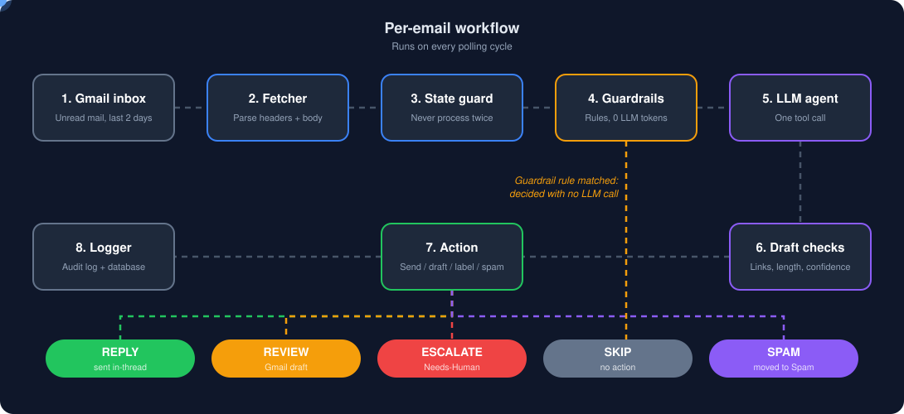

# Email Reply AI Agent

**A Gmail-integrated AI agent that reads incoming email, decides whether it needs a response, drafts that response in the sender's own language and tone, and sends it when it is confident enough.**

The live demo is read-only and uses sample data. No mailbox, API key or LLM is connected to it.

  
  
  
  
  

---

## Overview

The **Email Reply AI Agent** is an email-handling system built on top of the Gmail API and a Groq-hosted large language model. Unlike a simple auto-responder, it behaves like an agentic system: on every polling cycle it fetches recent unread mail, filters out noise, reasons about each message using LLM-driven tool calling, and independently chooses one of three actions: **reply**, **skip**, or **escalate to a human**. It then acts on that decision inside the user's actual Gmail account.

The project was built as a complete, end-to-end system rather than a proof of concept: authentication, decision-making, guardrails, sending, failure recovery, logging, a human-review console, a measured evaluation, automated testing, and a live demo website are implemented together as a single pipeline, and the agent has been run against a live Gmail inbox.

## Problem Statement

Individuals and small teams who manage their own inbox face a recurring set of problems:

- **Repetitive, low-value replies** (business hours, availability, simple queries) consume time that could be spent elsewhere.
- **Manual triage is inconsistent**: urgent messages, angry customers, or legal/refund disputes can sit unread alongside newsletters.
- **Naive "auto-reply" tools are unsafe.** They cannot tell a genuine customer complaint from a promotional email, cannot detect urgency or sentiment, answer automated mail in endless loops, and can send a wrong, invented, or tone-deaf reply with no human oversight.
- **Multilingual inboxes** (English, Urdu, Roman Urdu) are poorly served by most automation tools, which assume a single language.

A system that blindly replies to everything is not useful; it is a liability. What is needed is an agent that acts *only* when it is safe and appropriate to do so, and defers to a human otherwise.

## Our Solution

The Email Reply AI Agent addresses this by combining **agentic LLM tool-calling** with **deterministic, zero-token safety checks** that run both before and after the model call. Every email passes through:

1. **Fetching**: only new, unread messages from the last two days are considered, so an old backlog is never answered.
2. **Deduplication**: a local state store and an `AI-Processed` Gmail label ensure that no message is processed, or replied to, twice.
3. **Guardrails**: cheap, rule-based checks (automated and bulk mail, sender blacklists, learned spam, per-thread rate limits, prompt injection, legal/refund keywords, angry VIP senders) run first, without spending any LLM tokens.
4. **Agent reasoning**: a single Groq LLM call classifies intent, urgency, sentiment, and language, assigns a confidence score, and chooses an action, using only the facts written in the business information file. The draft is then checked before anything is sent.
5. **Action execution**: the agent replies in-thread through the real Gmail API, saves an uncertain reply as a draft for review, escalates to a human via a Gmail label, moves spam to the Spam folder, or takes no action.
6. **Logging**: every decision is recorded for auditability and can be reviewed in the human-review console.

The result is an agent that automates the repetitive part of inbox triage while deliberately routing the sensitive or ambiguous part to a human, instead of guessing.

## System Architecture

  

The animated diagram above shows the full decision pipeline the agent executes on every polling cycle: Gmail inbox, fetcher, state guard, guardrails, LLM agent, draft checks, action, and logger, ending in one of five outcomes (reply, review, escalate, skip, spam).

Only messages that pass every guardrail reach the LLM, which keeps the system fast and inexpensive to run on free-tier API limits.

## Key Features

- **Autonomous inbox loop**: continuously polls Gmail every 60 seconds until stopped, with no manual triggering required; `--once` processes the inbox a single time.
- **Real, in-thread Gmail replies**: not a simulated draft; replies are sent through the Gmail API, stay correctly threaded, and respect the sender's `Reply-To` address.
- **Agentic tool-calling decision-making**: the LLM itself selects between `reply_to_email`, `skip_email`, and `escalate_to_human` as callable tools, rather than the code guessing an intent from raw text.
- **Intent and category classification**: every email is labeled as `sales_inquiry`, `complaint`, `support_request`, `meeting_request`, `invoice_payment`, `general_query`, or `other`, and tagged with a matching Gmail label automatically.
- **Priority and urgency detection**: a free keyword pre-scan re-orders each polling batch so urgent messages are handled first, and the LLM assigns a final priority label.
- **Sentiment-aware replies**: negative or angry senders receive a more empathetic tone, and genuinely angry complaints are escalated rather than auto-replied to.
- **Multilingual support**: English, Urdu (script), and Roman Urdu are detected automatically, and the reply is drafted in the same language the sender used.
- **Confidence-gated sending**: if the model's confidence in a reply falls below a configurable threshold, or the draft contains a link or address that is not in the business file, the reply is not sent; it is saved as a Gmail draft and tagged `Needs-Review`.
- **Zero-token escalation rules**: legal-threat language, refund/payment disputes, prompt-injection attempts, and angry messages from VIP senders are force-escalated to a human before any LLM call is made, using whole-word matching so that harmless words like "courtesy" do not trigger them.
- **Self-learning spam filter**: spam-classification mistakes can be corrected via a simple CLI command; after two corrections, the agent adjusts its future treatment of that sender.
- **Real spam handling**: confirmed spam is moved into Gmail's Spam folder, not just silently ignored.
- **Structured logging**: every fetch, decision, and action is logged to `logs/agent.log` for auditability.
- **Automated test suite**: 128 tests cover the fetcher, sender/MIME, agent decision-making, guardrails, evaluation, webhook, and failure scenarios such as failed sends, crashes mid-send, a lost database, and Gmail label conflicts.
- **Optional real-time mode**: a Gmail Pub/Sub push-notification webhook is available as an alternative to polling.
- **Grounded answers only**: the agent may only state facts written in `knowledge/business_info.md`; when an answer needs anything else, such as prices or stock, it escalates instead of inventing one.
- **Protection against duplicate replies**: a reply is recorded before and immediately after it is sent, so a failed label update, a crash, or a lost database does not cause the same email to be answered twice.
- **Human-review console**: a local Streamlit dashboard shows escalated and uncertain emails, lets a person edit and send the AI's draft, and records whether each AI decision was correct.
- **Live demo website**: a read-only site with sample data where visitors can replay the agent's decisions step by step, browse the decision log and see the evaluation, without any access to a real mailbox.
- **Dry-run mode**: `--dry-run` shows every decision the agent would make without sending, labeling, or recording anything.
- **Measured evaluation**: the full decision pipeline was evaluated on 55 labeled emails in English, Urdu, and Roman Urdu, reaching 98.1% decision accuracy with no legitimate email sent to Spam. It is a small, self-built test set, so the numbers are an early indication rather than a guarantee.

## What Makes This Different

Most "email auto-reply" projects fall into one of two categories: a fixed if/else rule engine, or a thin wrapper that sends whatever the LLM outputs with no safety net. This project is neither.

- **Safety comes before intelligence.** Deterministic guardrails run *before* the LLM is ever called, so the riskiest categories of email (legal threats, payment disputes, angry VIPs) do not depend on model judgment at all.
- **One LLM call covers the analysis.** Intent, priority, sentiment, language, and confidence are all extracted from a single Groq tool-calling call, keeping the system within free-tier rate limits rather than chaining multiple API calls.
- **The agent knows when not to act.** Confidence scoring and draft checks mean the system is designed to hold back and defer to a human when it is unsure, rather than optimizing for reply volume.
- **It learns from corrections.** The spam-feedback loop adjusts how a sender is treated after repeated corrections, without retraining a model or writing new rules by hand.
- **It is bilingual.** Replies are drafted in the sender's own language, which most inbox-automation tools do not attempt.
- **It is measured, not just built.** Decisions are evaluated with business-risk metrics, such as how often a legitimate email is lost to Spam and how often an email that needed a person was answered automatically (1 of 20 in testing).

### Scenarios

| Scenario | Trigger | Expected Behavior | Log Entry |
|---|---|---|---|
| Promotional email | Any newsletter-type message | Filtered by guardrails, never reaches the LLM | `SKIP (source=guardrails)` |
| Normal query | e.g. "What are your business hours?" | LLM replies directly, in-thread | `REPLY` |
| Information not available | e.g. a delivery question the business file cannot answer | Escalated, `Needs-Human` label applied, no auto-reply sent | `ESCALATE` |
| Complaint / legal threat | e.g. refund demand with legal language | Escalated before any LLM call, `Needs-Human` label applied | `ESCALATE (source=guardrails)` |
| Uncertain reply | e.g. an unclear request answered with low confidence | Reply saved as a Gmail draft, `Needs-Review` label applied, nothing sent | `REVIEW` |
| Scam or phishing | e.g. "You won $10,000, send your bank details" | Moved to the Gmail Spam folder | `SPAM` |

## Conclusion

The Email Reply AI Agent demonstrates an end-to-end approach to inbox automation: it does not simply generate replies, it makes decisions about *when* to reply, *when* to stay silent, and *when* to hand control back to a human. By pairing deterministic safety guardrails with a single, grounded LLM reasoning step, checking its own drafts before sending, and measuring how often it gets those decisions right, the system aims to be cost-effective and careful enough to run against a real inbox, with a person kept in the loop for anything uncertain.
